<p align="center">
  
</p>

<p align="center">
  
  
  
</p>

---

### `> whoami`

```yaml
handle:    paulwyszynski
class:     Mobile App Developer
uplink:    Exxeta AG // Germany
shell:     terminal-first // Neovim, currently leveling up in Lua
mission:   looking to collaborate on creative and exciting projects
offline:   [hiking, gym, gravel_bike]
```

### `> ls ~/arsenal`

<p>
  
  
  
  
  
  
  
  
  
  
</p>

### `> ls ~/projects --featured`

| program | lang | payload |
| --- | --- | --- |
| [`fancyComposeCalculator`](https://github.com/paulwyszynski/fancyComposeCalculator) | Kotlin | A small calculator built with Compose architecture |
| [`customTextSelection`](https://github.com/paulwyszynski/customTextSelection) | Kotlin | Custom text selection in Compose with a custom popup menu |
| [`mri-casino-menu`](https://github.com/paulwyszynski/mri-casino-menu) | Go | Telegram bot that posts the daily canteen menu, running on a Raspberry Pi |
| [`dotfiles`](https://github.com/paulwyszynski/dotfiles) | Python | Backup of my tools and configs |

### `> cat /proc/activity`

<p align="center">
  
  
</p>

---

<p align="center"><code>// end of transmission — jack in, open a PR, say hi</code></p>
